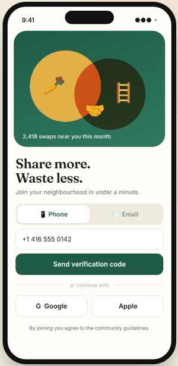
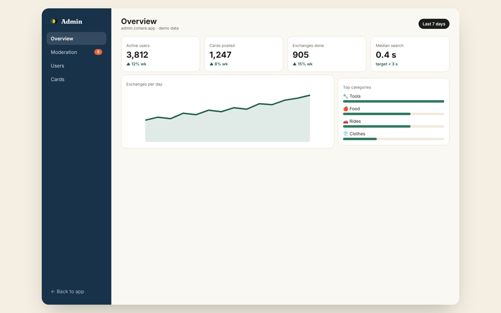

# Cohere — Community Sharing App (MVP demo)

**▶ Live demo: https://alexalghisi.github.io/CommonGrtound/**

Offer what you have, ask for what you need, and match with neighbours nearby.
Works on desktop and on phones, and can be installed as a PWA ("Add to Home Screen").

  
  

## Try it

1. Sign up with phone, email, Google or Apple (demo code **123456**)
2. Tap **＋** and post an offer or request. A neighbour matches within a few seconds and you get a push alert.
3. Open the chat, tap 📅 to agree a pick-up time, then mark the swap as completed and rate it.
4. Use the map, distance and category filters to find what's nearby.
5. Go to Profile → **Open admin dashboard** to moderate flagged cards, manage users and see analytics. Cards that contain words like "sell" are auto-flagged.

## Planned production stack

Flutter (iOS / Android / PWA) · Supabase (Auth, Postgres + PostGIS, Realtime, Storage, Edge Functions, Row-Level Security) · FCM / APNs push · Next.js admin.
All traffic over HTTPS, data encrypted at rest.

> This is a front-end demo build. Data is sample data and stays in your browser. Use "Reset demo data" in Profile to start over.

© Alessandro Alghisi
